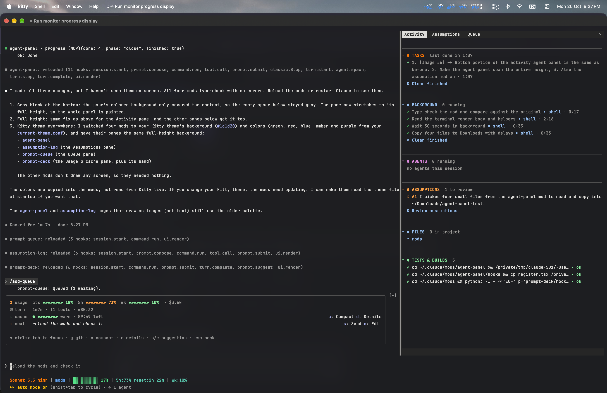
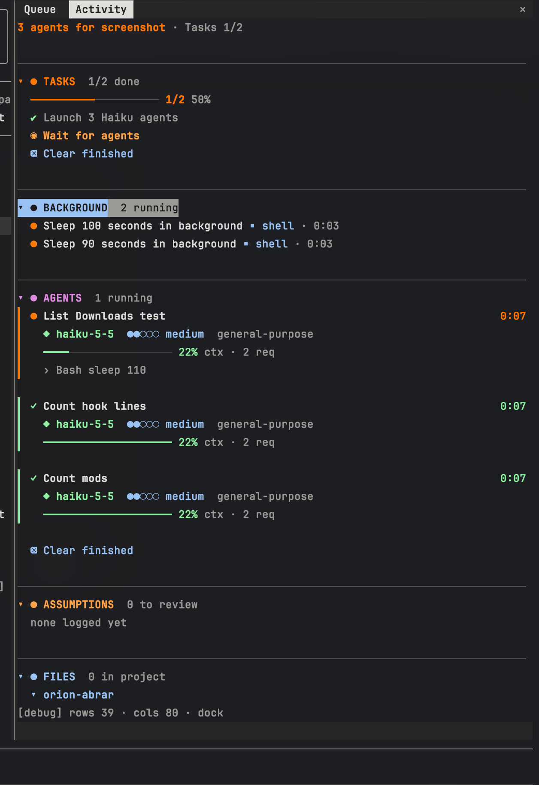
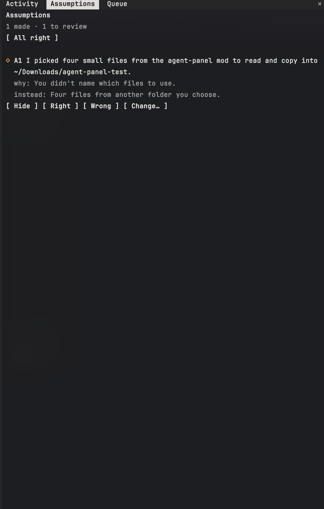
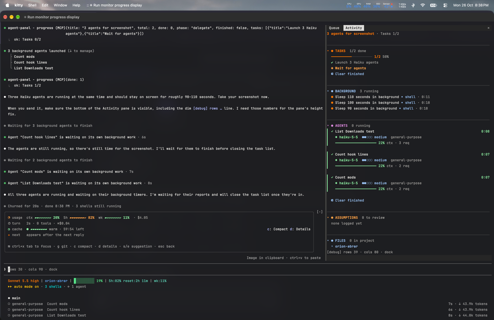
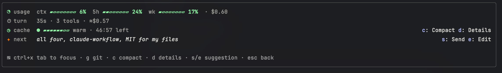
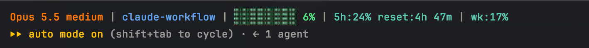

# claude-workflow

My Claude Code setup: 11 mods I built, a skill I wrote, my global `CLAUDE.md`, my status line, and the third-party plugins I use. Copy all of it with one script, or install only the parts you want.



## Quick start (everything)

```sh
git clone https://github.com/Abrar118/claude-workflow.git
cd claude-workflow
./install.sh
```

The script:
- adds this repo as a plugin marketplace and installs every mod and skill
- installs the third-party plugins listed below
- copies the status line script
- copies `CLAUDE.md`, but only if you don't already have one; otherwise it's saved next to yours as `CLAUDE.workflow.md`

Then merge the parts of [`settings.example.json`](settings.example.json) you want into `~/.claude/settings.json` (the status line block at least), and restart Claude Code.

A step-by-step guide with screenshots is in [`docs/setup-guide.pdf`](docs/setup-guide.pdf).

## Install one mod

This repo is a Claude Code plugin marketplace. At the Claude Code prompt:

```
/plugin install agent-panel --marketplace Abrar118/claude-workflow
```

Answer `y` to add the marketplace, then pick a scope (user is the default). From a shell:

```sh
claude plugin install agent-panel --marketplace Abrar118/claude-workflow
```

## My mods

Mods are Claude Code plugins that change the interface or hook into what Claude does.

| Mod | What it does |
|---|---|
| **agent-panel** | Side pane (`/subagents`) with tasks, background jobs, agents (model, effort, context use), assumptions and a live file tree. Adds a progress bar above the prompt and `progress`/`step` tools Claude uses to report its plan. |
| **assumption-log** | Claude logs each assumption it makes with an `assume` tool. The Assumptions pane (`/assumptions`) lets you mark each one right or wrong, or ask for a change. |
| **prompt-deck** | Band above the prompt: context, 5h and weekly usage, session cost, prompt-cache countdown with a compact warning, git health and a suggested next prompt. `/limits` opens a pane. |
| **prompt-queue** | `/add-queue` saves a prompt idea while Claude works. `/queue` opens a pane to send, modify or discard them. |
| **turn-meter** | Time, tool calls and cost for each turn, shown in the prompt-deck band, plus a toast when a turn costs far more than usual. |
| **limit-guard** | Warns as the 5-hour limit fills up, and asks before starting subagents when it is nearly used up. |
| **safety-guard** | Asks before force pushes, pushes to main, merges into main (`git merge` while on main, `gh pr merge`, the GitHub merge-PR tool), `rm -rf`, hard resets, `DROP`/`TRUNCATE`, `flyway clean` and `.env` edits or shell writes. Block is the default answer. |
| **push-preflight** | Before `git push`, runs the repo's `format:check`, `lint` and `typecheck` scripts, and blocks the push if one fails. |
| **format-on-edit** | After each edit, runs the project's own formatter (Prettier, `dart format` or Spotless), only where the project already uses one. |
| **venv-auto** | Activates the nearest `.venv` for `python`, `pip` and `pytest` commands. |
| **debug-on-paste** | When a pasted message looks like an error or stack trace, tells Claude to debug step by step. |

<p>
  
  
  
</p>



**About the theme:** the panes use colors from my Kitty terminal theme (background `#1d1d20`), set in each mod's `hooks/register.tsx`. Change them there to match your terminal.

**turn-meter and prompt-deck** work together: prompt-deck shows what turn-meter measures. Install both.

## My skill

**verify-outside-feedback**: when you paste a review, critique or list of suggestions, Claude splits it into claims and marks each one Confirmed, Refuted or Unclear, with evidence such as `file:line`, test output or a quoted source. Then it asks before changing anything.

```
/plugin install verify-outside-feedback --marketplace Abrar118/claude-workflow
```

## Status line



[`statusline/statusline-command.sh`](statusline/statusline-command.sh) shows the model and effort, repo or folder, git branch, a context bar, 5h usage with reset time, weekly usage and the open PR. It needs `jq`; the PR badge needs `gh`.

```sh
cp statusline/statusline-command.sh ~/.claude/
```

```json
"statusLine": { "type": "command", "command": "sh ~/.claude/statusline-command.sh" }
```

## CLAUDE.md

[`CLAUDE.md`](CLAUDE.md) is my global instructions file (`~/.claude/CLAUDE.md`): short answers, no over-engineering, simplest code that works, read before claiming, and run outside feedback through the skill above.

## Third-party plugins and skills I use

These aren't mine and aren't included here. Install them from their sources.

| Plugin / skill | By | Why I use it | Install |
|---|---|---|---|
| [superpowers](https://github.com/anthropics/claude-plugins-official) | official marketplace | Brainstorm → plan → TDD → debug → review process | `/plugin install superpowers@claude-plugins-official` |
| frontend-design | official marketplace | Distinctive UI, not template defaults | `/plugin install frontend-design@claude-plugins-official` |
| security-guidance | official marketplace | Security warnings while editing | `/plugin install security-guidance@claude-plugins-official` |
| claude-md-management | official marketplace | Audit and update CLAUDE.md files | `/plugin install claude-md-management@claude-plugins-official` |
| claude-code-setup | official marketplace | Suggests hooks, skills and MCP servers for a repo | `/plugin install claude-code-setup@claude-plugins-official` |
| remember | official marketplace | Saves session state between sessions | `/plugin install remember@claude-plugins-official` |
| github | official marketplace | GitHub MCP tools | `/plugin install github@claude-plugins-official` |
| [ui-ux-pro-max](https://github.com/nextlevelbuilder/ui-ux-pro-max-skill) | nextlevelbuilder | Searchable styles, palettes and font pairings | `/plugin install ui-ux-pro-max --marketplace nextlevelbuilder/ui-ux-pro-max-skill` |
| design-system | claudekit, via the [ui-ux-pro-max CLI](https://github.com/nextlevelbuilder/ui-ux-pro-max-skill) | Design tokens and component specs | `npm i -g ui-ux-pro-max-cli && uipro init --global` |
| [Uncodixfy](https://github.com/cyxzdev/Uncodixfy) | cyxzdev | Stops generic AI-looking UI | `git clone https://github.com/cyxzdev/Uncodixfy ~/.claude/skills/uncodixfy` |

Also installed but used less often: `feature-dev`, `code-review`, `pr-review-toolkit` and `code-simplifier` from the official marketplace.

## How I use it all

See [WORKFLOW.md](WORKFLOW.md).

## Repo layout

```
.claude-plugin/marketplace.json   makes this repo installable with /plugin
mods/<name>/                      one folder per mod (manifest, hooks, tests)
plugins/verify-outside-feedback/  my skill, packaged as a plugin
statusline/                       status line script
CLAUDE.md                         my global instructions
settings.example.json             the relevant parts of my settings.json
install.sh                        installs everything
docs/                             screenshots and the PDF setup guide
```

## Developing the mods

Each mod has tests: `claude plugin test mods/<name>`. To run a mod from a local folder without installing it, start Claude Code with `claude --plugin-dir mods/<name>`.

## License

MIT for my own files (see [LICENSE](LICENSE)). The third-party plugins and skills above belong to their authors and are under their own licenses.
